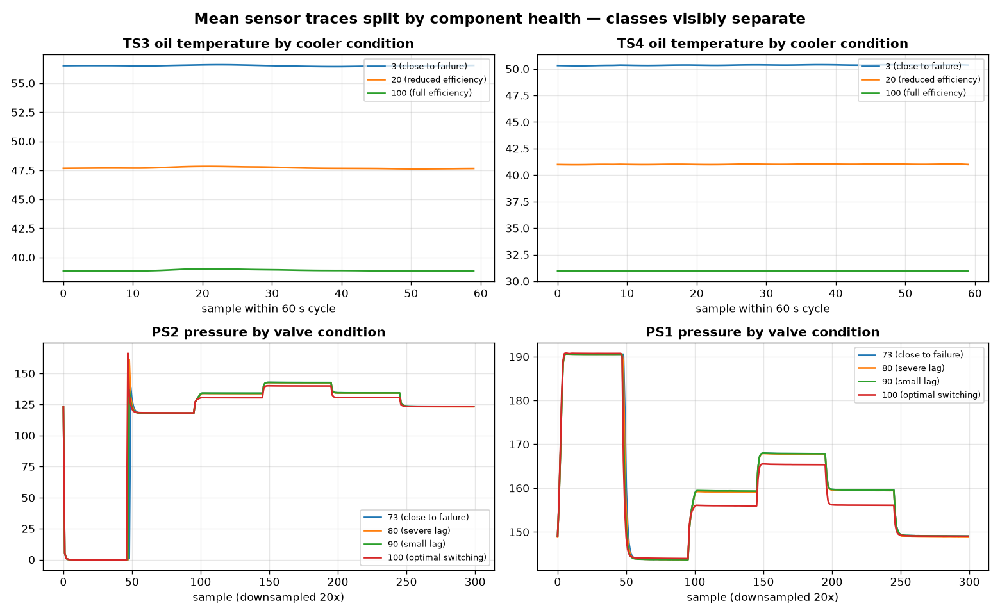
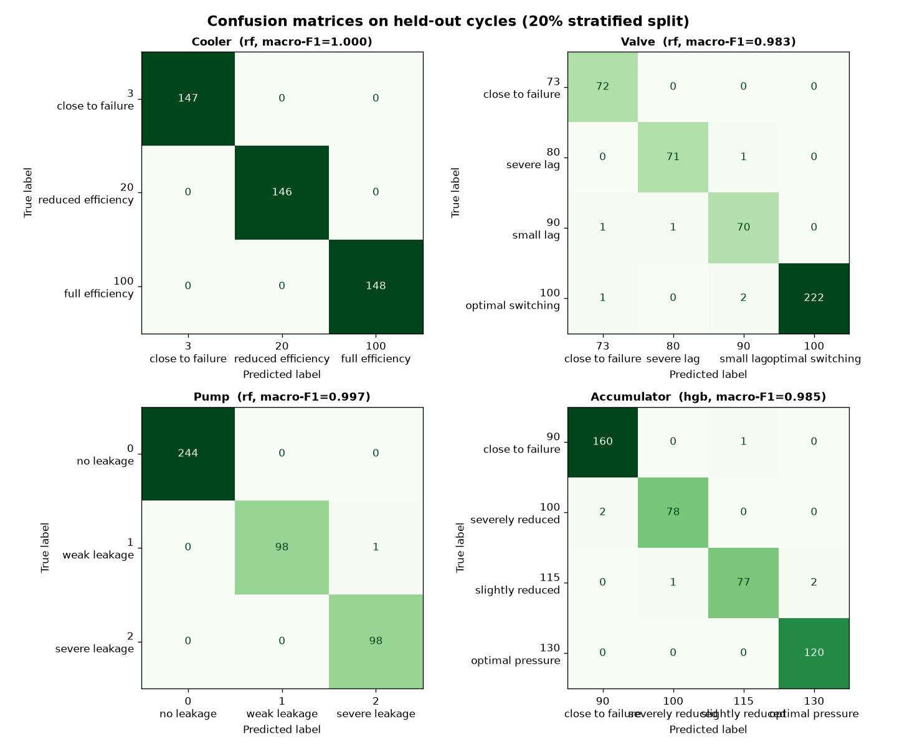
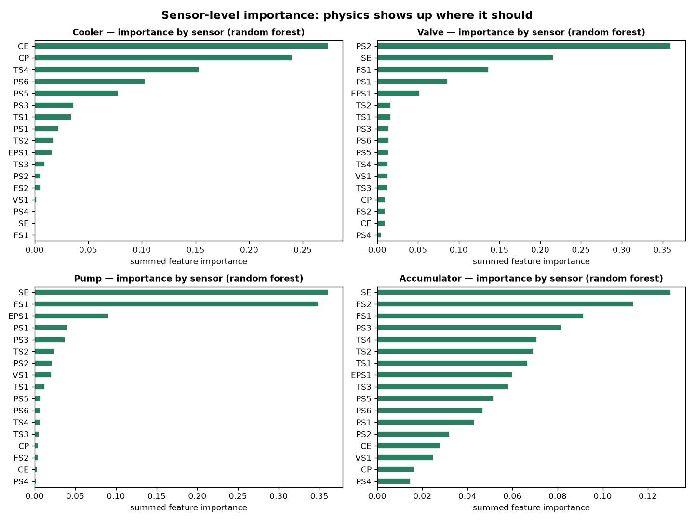

# Hydraulic System Condition Monitoring — The Complete Project Guide

*How I built it, why each step exists, and what every result means. Written to be read, learned, defended in interviews, and adapted into articles.*

---

## How to use this guide

This is not a code dump. Every section follows the same rhythm I used while doing the work:

1. **What I did** — the concrete step, with the exact commands and code
2. **What came out** — the output, chart, or number
3. **What it means** — the interpretation, in plain language
4. **Why it matters / what I decided next** — the product judgment

If you can explain all four for every section, you can defend this project in any interview.

---

## Part 1 — The problem (start here, not with code)

Unplanned hydraulic failures stop production lines. A failed cooler or a leaking pump doesn't just cost a spare part — it costs the unplanned shutdown, the rush technician visit, and the production that didn't happen.

But here's the thing most ML tutorials miss: **"something is wrong" is not an actionable prediction.** A maintenance planner needs three answers:

1. **Which component** is degrading — cooler, valve, pump, or accumulator?
2. **How badly** — full efficiency, reduced, or close to failure?
3. **What should I do about it** — and when?

This project answers the first two. (The third becomes Project #3 in my portfolio: a maintenance *decision* engine.)

That framing matters. Anyone can train a classifier. A product person starts from the decision the prediction enables.

---

## Part 2 — The data

### What it is

The dataset comes from a hydraulic test rig at a research lab, published by Helwig et al. to the **UCI Machine Learning Repository** (2018). It contains **2,205 operating cycles**, each 60 seconds long, recorded under systematically varied component health states. Because the fault states were *induced deliberately*, the labels are trustworthy — this is the closest public analog to labeled industrial asset data, which is notoriously hard to get.

> Independence note (I state this in every portfolio project): this is public research data. Not affiliated with any employer; no proprietary data used.

### The sensors — 17 of them, at 3 sampling rates

| Sensors | Measures | Rate | Samples/cycle |
|---|---|---|---|
| PS1–PS6 | Pressure (bar) | 100 Hz | 6,000 each |
| EPS1 | Motor power (W) | 100 Hz | 6,000 |
| FS1–FS2 | Volume flow (l/min) | 10 Hz | 600 each |
| TS1–TS4 | Temperature (°C) | 1 Hz | 60 each |
| VS1 | Vibration (mm/s) | 1 Hz | 60 |
| SE | Efficiency factor (%) | 1 Hz | 60 |
| CE | Cooling efficiency (%) | 1 Hz | 60 |
| CP | Cooling power (kW) | 1 Hz | 60 |

Total: **43,680 raw values per cycle**. That number matters — it tells you immediately that no classifier will ingest this raw. We need compression first (Part 4).

### The targets — 4 components, each with its own health states

| Component | Values | Meaning | Cycles |
|---|---|---|---|
| Cooler | 3 / 20 / 100 | close to failure / reduced efficiency / full efficiency | 732 / 732 / 741 |
| Valve | 73 / 80 / 90 / 100 | close to failure / severe lag / small lag / optimal | 360 / 360 / 360 / 1125 |
| Pump | 0 / 1 / 2 | no leakage / weak leakage / severe leakage | 1221 / 492 / 492 |
| Accumulator | 90 / 100 / 115 / 130 | close to failure / severely reduced / slightly reduced / optimal | 808 / 399 / 399 / 599 |

Two observations I made before writing any model code:

1. **Cooler is near-balanced; the others aren't.** Valve's "optimal" class has 1,125 cycles vs 360 for each fault state. A lazy model could score well by always predicting "optimal." That's why I evaluate with **macro-F1** later, not just accuracy — macro-F1 forces every fault state to count equally.
2. **Every class has ≥360 cycles.** Enough for stratified splits to work. If a fault state had 20 examples, I'd be writing a very different (anomaly-detection) project.

### Setup — exact commands

```bash
# 1. Get the code + this guide onto your machine, then create an isolated environment
cd 01-hydraulic-condition-monitoring
python3 -m venv .venv
source .venv/bin/activate   # Windows: .venv\Scripts\activate

# 2. Install dependencies
pip install -r requirements.txt

# 3. Download the dataset (~500 MB, public UCI archive)
python data/download_data.py

# 4. Open the notebooks
jupyter notebook notebooks/
```

The `.gitignore` excludes the raw `.txt` data files — they're too large for GitHub, and `download_data.py` reproduces them deterministically.

---

## Part 3 — Exploratory analysis: do the signals separate the faults?

**The single most important EDA question.** Before any modeling: *if I plot the average sensor trace for each fault class, do the curves separate?* If yes, a classifier has something real to learn. If no, I'm wasting my time.

### Step 3.1 — Load and sanity-check

```python
from src.data import load_profile, load_sensor, TARGETS, TARGET_LABELS

profile = load_profile()
print("cycles:", len(profile))   # 2205
profile.head()                   # cooler, valve, pump, accumulator, stable
```

Output: 2,205 rows, 5 columns, no missing values, integer labels exactly matching the documented health states. **Interpretation:** the data is clean and the labels are as documented — no surprises, which is itself information (real industrial data is never this clean; I note that in the limitations).

### Step 3.2 — Class distributions

I plotted bar charts for all four targets (`reports/figures/01_target_distributions.png`).

**What I saw:** cooler is essentially balanced; valve/pump/accumulator skew toward healthy states — which mirrors reality (failures are rarer than healthy operation).

**Decision it drove:** use **stratified** train/test splits so every fault state appears in both sets, and judge models by **macro-F1**, not accuracy.

### Step 3.3 — The physics check (my favorite chart)

I plotted mean sensor traces split by health state, testing two physical hypotheses:

- *Hypothesis A:* a degraded cooler can't reject heat → **oil temperature sensors (TS3/TS4) should run hotter** as cooler condition worsens.
- *Hypothesis B:* a lagging valve changes switching dynamics → **pressure sensors (PS1/PS2) should show reshaped plateaus**.



**What I saw:**
- **Hypothesis A confirmed, dramatically.** On TS3, a cooler "close to failure" runs at ~56°C vs ~39°C at full efficiency — a **~17°C separation**, visible to the naked eye. TS4 shows the same pattern. The classes don't just separate; they separate *in the physically expected direction*.
- **Hypothesis B confirmed.** PS1/PS2 pressure plateaus shift and reshape across valve lag states — the switching dynamics literally change shape.

**Why this matters (product lens):** this chart is the single best artifact in the project for a non-technical stakeholder. Before showing any model score, I can show a plant manager this image and say: *"Your sensors already see the failure coming. We're just teaching a computer to watch them 24/7."* That sentence is worth more than any F1 score in a stakeholder meeting.

**Decision it drove:** proceed to modeling with confidence, using per-cycle statistical features — the signal is in the *level and shape* of these traces, which simple statistics capture well.

---

## Part 4 — Feature engineering: 43,680 numbers → 187 features

### Why not feed raw signals to a model?

43,680 values per cycle × 2,205 cycles is ~96 million numbers. A classifier *could* ingest them, but (a) it's slow, (b) it's opaque, and (c) for a 60-second steady cycle, most of the information is in the signal's *statistics*, not each individual sample. The standard, honest baseline for this benchmark is statistical feature extraction — and baselines you can explain beat black boxes you can't, especially when a maintenance engineer asks "why did it flag my pump?"

### The 11 features per sensor (and what each means physically)

```python
def signal_features(x):
    x = np.asarray(x, dtype=float)
    rms = np.sqrt(np.mean(x ** 2))
    return {
        "mean":   np.mean(x),          # operating level (e.g. steady temperature)
        "std":    np.std(x),           # fluctuation around the level
        "min":    np.min(x),
        "max":    np.max(x),
        "median": np.median(x),        # robust level, ignores spikes
        "ptp":    np.ptp(x),           # peak-to-peak swing
        "rms":    rms,                 # signal energy level
        "crest":  np.max(np.abs(x)) / (rms + 1e-12),  # spikiness: transients & impacts
        "skew":   stats.skew(x),       # asymmetry (e.g. one-sided pressure spikes)
        "kurt":   stats.kurtosis(x),   # tailedness (impulsive events)
        "energy": np.mean(x ** 2),     # total signal energy
    }
```

17 sensors × 11 features = **187 features per cycle**. Each one is explainable in one sentence to a domain engineer — that explainability is a *feature*, not a limitation.

The full implementation lives in `src/data.py:build_feature_frame()`, which processes sensors one file at a time (the raw files total ~500 MB — loading everything at once would blow memory; this is the kind of boring engineering detail interviewers appreciate hearing).

---

## Part 5 — Modeling: four small problems, not one big one

### Decision 1: one classifier per component

The four components degrade **independently** (the test rig varies them independently). A single multi-output model would entangle unrelated failure modes. Four focused classifiers are simpler, more debuggable, and map 1:1 to maintenance actions ("the *cooler* needs attention"). When the problem decomposes naturally, decompose the model too.

### Decision 2: RandomForest vs HistGradientBoosting

Tree ensembles are the right tool here: they handle mixed feature scales without normalization, they're robust to correlated features (many of my 187 overlap), and they give feature importances for free. I compared both and kept the winner **per component** by macro-F1:

```python
for t in TARGETS:
    X_train, X_test, y_train, y_test = train_test_split(
        X, y[t].values, test_size=0.2, random_state=42, stratify=y[t].values)
    for name, model in [("rf", RandomForestClassifier(n_estimators=300, n_jobs=-1,
                                                       random_state=42)),
                        ("hgb", HistGradientBoostingClassifier(random_state=42))]:
        model.fit(X_train, y_train)
        pred = model.predict(X_test)
        # accuracy AND macro-F1 recorded for every combination
```

### Decision 3: no leakage, by construction

Features are computed **per cycle**, and the split is **by cycle** (stratified 80/20, fixed seed 42). No cycle appears in both train and test. This sounds obvious, but leakage through overlapping time windows is the #1 silent killer of time-series ML credibility — stating the discipline explicitly is what separates a careful practitioner from a notebook hobbyist.

---

## Part 6 — Reading the results like a maintenance planner

### The scores (held-out 441 cycles)

| Component | Best model | Accuracy | Macro-F1 |
|---|---|---|---|
| Cooler | RF / HGB | 1.000 | 1.000 |
| Pump leakage | RandomForest | 0.998 | 0.997 |
| Valve | RandomForest | 0.986 | 0.983 |
| Accumulator | HistGradientBoosting | 0.986 | 0.985 |

These are strong — almost suspiciously strong. The honest read: **test-rig data with deliberately induced, well-separated fault states is the easy case.** Real plant data adds sensor drift, missing readings, and mixed fault modes. I say this in the README and I'd say it in an interview *before* being asked — volunteering limitations builds more credibility than perfect scores do.

### Confusion matrices — where errors concentrate



**How to read these as a maintenance planner, not a data scientist:**

- **Cooler:** a clean diagonal. The model never confuses the states. Operationally: you can trust a "reduced efficiency" flag enough to *schedule* a cooler service, not just investigate.
- **Valve / accumulator:** nearly clean diagonals with a handful of confusions between *adjacent* degradation states (e.g., "small lag" vs "severe lag"). This is the *good kind* of error — the model occasionally misjudges severity, but essentially never mistakes a healthy valve for a failing one or vice versa. For maintenance, direction matters more than precision: the action (inspect the valve) is the same.
- **The expensive error to watch:** predicting "healthy" when the truth is "close to failure." Across all four matrices, that cell is essentially empty. That's the outcome that prevents unplanned shutdowns, and it's what I'd monitor in production.

---

## Part 7 — Which sensors matter: the product insight



I aggregated feature importance back to the **sensor** level (importance from the random-forest model, the interpretable one). The model rediscovers the physics:

| Component | Top sensors | Physical sense |
|---|---|---|
| Cooler | CE, CP, TS4 | cooling efficiency/power + temperature — exactly the heat-rejection loop |
| Valve | PS2, SE, FS1 | pressure + flow — the switching dynamics |
| Pump | SE, FS1, EPS1 | efficiency + flow + motor power — a leaking pump moves less fluid per watt |
| Accumulator | SE, FS2, FS1, PS3 | efficiency + flow + pressure — the storage/discharge loop |

**Why this is the most "product manager" chart in the project:** it answers a *budget* question, not a modeling question. If temperature and cooling sensors dominate cooler prediction, a plant can instrument *just those* on a retrofit and skip the expensive 100 Hz pressure array. **ML tells you what to predict; feature importance tells you what to buy.** That's the sentence I'd use with a VP of Operations.

---

## Part 8 — Limitations and what I'd do next (say this before they ask)

1. **Test rig ≠ plant floor.** Real data has drift, dropouts, and fault modes nobody induced on purpose. Next: robustness testing with synthetic sensor noise and missing-data regimes.
2. **Single split, single seed.** Scores are indicative. Next: repeated stratified CV with confidence intervals.
3. **Fixed 60-second framing.** A streaming deployment needs windowing, latency budgets, and alert debouncing — otherwise you page someone 60 times for one degrading cooler.
4. **No spectral features yet.** The 100 Hz pressure/power signals deserve FFT-band features; the statistics-only baseline leaves information on the table.
5. **No sequence models tried.** A 1D-CNN/LSTM on raw signals is the natural challenger to this baseline — I'd run that comparison before claiming the feature approach is sufficient.

---

## Part 9 — From model to product (the AI product manager section)

A model in a notebook saves nobody money. Here's how I'd productize this, and how I'd talk about it in a Director/Head/AI-Lead interview:

**Users & decisions.** Reliability engineers and maintenance planners. The decision: *which work orders to raise this week, with what priority.* The model's output must land in the existing CMMS/work-order flow — not another dashboard nobody opens.

**KPIs that matter.** Not F1 — *unplanned downtime hours avoided, false-alarm rate per 100 cycles* (alert fatigue kills adoption), and *mean lead time* (how many cycles of warning before "close to failure"). I'd instrument all three from day one of a pilot.

**Rollout.** Shadow mode first: run predictions alongside human planners for 4–6 weeks, compare, then graduate to "recommend" and only later to "auto-raise low-risk work orders." Trust is deployed in stages.

**The cost layer (→ Project #3).** A prediction becomes a decision when you attach economics: *cost of unplanned downtime × probability of failure* vs *cost of planned intervention*. That's the maintenance decision engine — the next project in this portfolio — and it's where the MBA meets the ML.

---

## Part 10 — Interview prep: questions I'd expect, answers I'd give

**Q: Why one model per component instead of multi-output?**
A: The rig varies components independently, so the failure modes are independent. Separate models are simpler to debug, map 1:1 to work orders, and let me pick the best algorithm per component (HGB won accumulator, RF won the rest).

**Q: Why macro-F1 instead of accuracy?**
A: Accuracy lets a model hide behind the majority healthy class — valve is 51% "optimal." Macro-F1 forces every fault state to count equally, and missing a rare "close to failure" is the expensive error in maintenance.

**Q: How did you avoid leakage?**
A: Features are computed per 60-second cycle and the split is by cycle — no cycle in both sets. With time-series data I'd also worry about overlapping windows leaking across the split; here the cycles are independent by construction.

**Q: Why statistical features instead of deep learning on raw signals?**
A: Three reasons: (1) it's the honest baseline for this benchmark and it's explainable to the engineers who'd trust the system; (2) 187 features train in seconds and the scores are already near-ceiling; (3) I'd still run a 1D-CNN challenger next — I list that as an explicit next step rather than pretending the baseline is the final answer.

**Q: Your cooler accuracy is 1.0 — isn't that overfitting?**
A: It's the easy case, not overfitting: test-rig data, deliberately induced faults, and a 17°C temperature separation visible to the naked eye (see the EDA chart). I'd say this upfront. The real test is plant data with drift and mixed modes.

**Q: How would you deploy this?**
A: Shadow mode beside human planners → recommend → auto-raise low-risk work orders. Instrument false-alarm rate and lead time, not just F1. And the predictions feed a cost-based decision engine (my next project).

**Q: What would you do with twice the time?**
A: Spectral features for the 100 Hz signals, a sequence-model challenger, repeated CV with intervals, robustness tests with missing data, and the streaming/windowing design for real deployment.

---

## Part 11 — Sharing this work

### LinkedIn post (adapt freely)

> Unplanned hydraulic failures don't start as failures — they start as a cooler running 17°C hotter than it should.
>
> I built a condition-monitoring project on public test-rig data (2,205 cycles, 17 sensors) that predicts which component is degrading — cooler, valve, pump, accumulator — and how badly.
>
> What I found most interesting wasn't the 98%+ scores. It was that the model rediscovers the physics: temperature sensors dominate cooler prediction, pressure sensors dominate valve prediction. ML tells you what to predict; feature importance tells you where to spend instrumentation budget.
>
> Full write-up + code: [repo link]. Next: turning these predictions into maintenance *decisions* with a cost-based decision engine.
>
> #PredictiveMaintenance #IndustrialAI #MachineLearning #AssetManagement

### Medium article outline

1. The maintenance planner's real question (Part 1 above)
2. What the data looks like, and the 17°C chart (Parts 2–3)
3. From 43,680 numbers to 187 features (Part 4)
4. Four small models, honest evaluation (Parts 5–6)
5. The sensor-importance insight (Part 7)
6. Limitations I'd state before you ask (Part 8)
7. From notebook to work order: productizing it (Part 9)

---

*Built with Python, scikit-learn, pandas, matplotlib. Data: Helwig et al., UCI Machine Learning Repository (2018) — public research data, independent project.*
