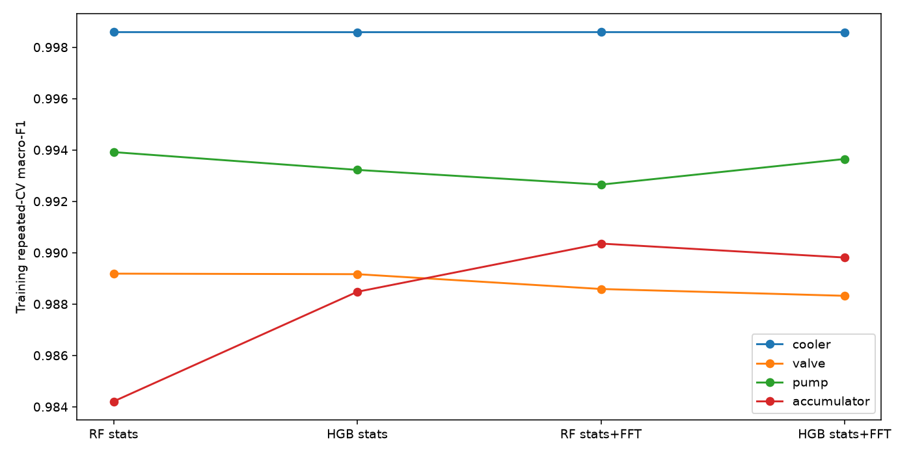
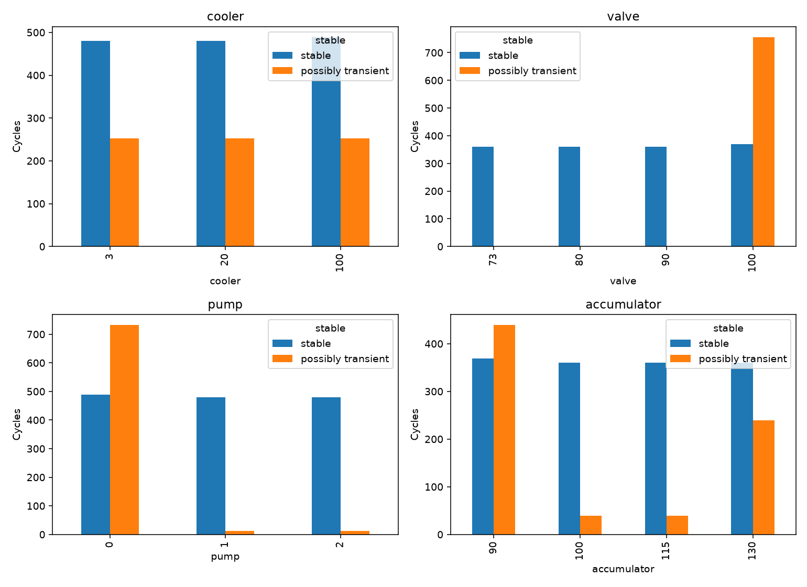
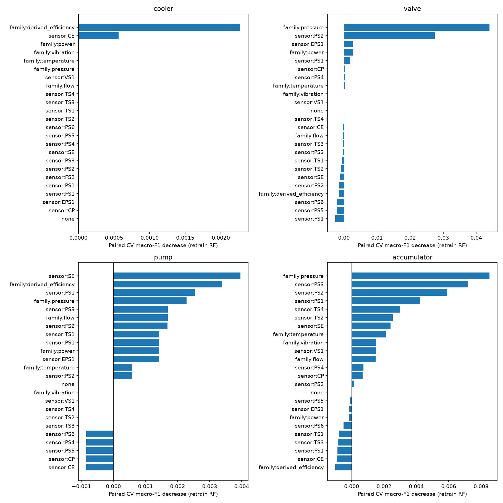

# Project guide: evaluating hydraulic condition classifiers

## 1. What the project measures

The task is four separate supervised classifications of the annotated state during a 60-second laboratory cycle. It is not forecasting future failure. Labels are cooler {3,20,100}, valve {73,80,90,100}, pump {0,1,2}, accumulator {90,100,115,130}. Macro-F1 gives each state equal weight; it is not a measured downtime cost.

## 2. Data and features

2,205 cycles contain 43,680 values each: 7×6000 + 2×600 + 8×60. Download is 76,601,704 bytes for the archive used here (roughly 73.1 MiB); extracted text is larger. `reports/data_manifest.json` records SHA-256 hashes.

Each of 17 channels yields mean, population SD, min, max, median, range, RMS, crest factor, skew, excess kurtosis and mean-square energy. Constant-signal skew/kurtosis are defined as zero. Empty, nonfinite, invalid-label or misaligned inputs are rejected. Redundancies such as energy=RMS² remain for continuity with the original baseline; tree models tolerate them, but importance requires caution.

Seven 100 Hz pressure/power channels additionally yield dominant frequency, spectral centroid, and relative power in [0,1), [1,5), [5,20), [20,50] Hz bands. Signals are demeaned and Hann-windowed; DC is excluded. These summarize the repeated load cycle; they are not calibrated physical power spectral density or proof of fault-frequency mechanisms. No high-frequency vibration claim is made from VS1's 1 Hz readings.

## 3. Evaluation protocol

Per-target stratified 80/20 split with seed 2026; split indices are stored. Different targets have different test IDs. Only training data enters 5-fold stratified CV repeated twice, with identical folds across all four candidates. RF uses 150 trees; HGB uses 100 iterations with early stopping disabled. Both use seed 2026 and default remaining hyperparameters. No additional hyperparameter search was performed. Highest mean macro-F1 wins; exact ties use candidate order (statistics RF, statistics HGB, FFT RF, FFT HGB).

After training-only diagnostics, refit the winner on all 1,764 training cycles and predict the 441 test cycles once. Store truth and predictions; bootstrap, subgroups and confusion matrices use the stored prediction vector. `stable` and cycle ID are not predictors. Audit and protocol were committed before results.

| Target | Selected model / features | CV mean ± SD | Test accuracy | Test macro-F1 (95% CI) |
| --- | --- | --- | --- | --- |
| cooler | rf / statistics | 0.9986 ± 0.0020 | 0.9977 | 0.9977 (0.9932–1.0000) |
| valve | rf / statistics | 0.9892 ± 0.0042 | 0.9751 | 0.9657 (0.9441–0.9839) |
| pump | rf / statistics | 0.9939 ± 0.0084 | 0.9955 | 0.9943 (0.9841–1.0000) |
| accumulator | rf / statistics_fft | 0.9904 ± 0.0047 | 0.9932 | 0.9915 (0.9808–1.0000) |

### Statistical versus FFT comparison (training only)

| Target | Candidate | Features | CV mean | Fold SD |
| --- | --- | --- | --- | --- |
| cooler | rf | statistics | 0.9986 | 0.0020 |
| cooler | hgb | statistics | 0.9986 | 0.0015 |
| cooler | rf | statistics_fft | 0.9986 | 0.0020 |
| cooler | hgb | statistics_fft | 0.9986 | 0.0015 |
| valve | rf | statistics | 0.9892 | 0.0042 |
| valve | hgb | statistics | 0.9892 | 0.0051 |
| valve | rf | statistics_fft | 0.9886 | 0.0045 |
| valve | hgb | statistics_fft | 0.9883 | 0.0048 |
| pump | rf | statistics | 0.9939 | 0.0084 |
| pump | hgb | statistics | 0.9932 | 0.0083 |
| pump | rf | statistics_fft | 0.9927 | 0.0085 |
| pump | hgb | statistics_fft | 0.9936 | 0.0083 |
| accumulator | rf | statistics | 0.9842 | 0.0098 |
| accumulator | hgb | statistics | 0.9885 | 0.0064 |
| accumulator | rf | statistics_fft | 0.9904 | 0.0047 |
| accumulator | hgb | statistics_fft | 0.9898 | 0.0070 |



This is a controlled candidate comparison using the same folds. Small differences do not establish a statistically significant improvement; correlated fold scores are not independent replicates. The final test only scores the selected candidate, avoiding a second round of test-based feature selection.

## 4. Stability and class composition

There are 1,449 stable and 756 possibly transient cycles. The latter contain only valve class 100 and pump counts {0:732,1:12,2:12}. Stability is associated with the experimental condition mix; these data cannot isolate a causal effect of transients.

| Target | Flag | Test cycles | Class support (label order) | Accuracy | Fixed-label macro-F1 |
| --- | --- | --- | --- | --- | --- |
| cooler | 0 | 287 | [92, 93, 102] | 1.0000 | 1.0000 |
| cooler | 1 | 154 | [54, 54, 46] | 0.9935 | 0.9938 |
| valve | 0 | 292 | [72, 72, 72, 76] | 0.9623 | 0.9624 |
| valve | 1 | 149 | [0, 0, 0, 149] | 1.0000 | 0.2500 |
| pump | 0 | 294 | [102, 95, 97] | 0.9932 | 0.9932 |
| pump | 1 | 147 | [142, 3, 2] | 1.0000 | 1.0000 |
| accumulator | 0 | 287 | [78, 69, 72, 68] | 0.9930 | 0.9931 |
| accumulator | 1 | 154 | [83, 11, 8, 52] | 0.9935 | 0.9734 |

Label order for support vectors is the ascending order listed in section 1. Fixed-label macro-F1 includes every target class and assigns zero to absent classes. Consequently a perfect single-class valve subgroup scores 0.25, not 1.0; consult accuracy and class support together. Sparse classes make subgroup intervals especially uncertain. Full subgroup recalls and intervals are in metrics.json. No stable-only retraining was used to select the model.



## 5. Explainability and retrained ablation

The selected candidate is fitted on the first training CV fold and evaluated on its validation fold. Feature permutation and grouped sensor permutation use five shuffles. Grouped permutation moves a sensor's columns together, retaining within-sensor correlations. Neither uses final-test rows. Validation importance is exploratory and can be optimistic after candidate selection on overlapping training folds.

Separately, a fixed RF using all 229 features is retrained on identical three-fold training splits after removing each of 17 sensors and each of six sensor families. Paired decreases compare each ablation to the full RF on the same folds. Negative values mean a small improvement after removal; they are not suppressed. Single-channel families duplicate their corresponding sensor ablation by design. This diagnostic baseline may differ from the selected final model.

Largest mean decreases (five per target):

| Target | Removed | Mean paired F1 decrease | Three paired decreases |
| --- | --- | --- | --- |
| cooler | family:derived_efficiency | 0.0023 | 0.0017, 0.0034, 0.0017 |
| cooler | sensor:CE | 0.0006 | 0.0017, 0.0000, 0.0000 |
| cooler | sensor:CP | 0.0000 | 0.0000, 0.0000, 0.0000 |
| cooler | sensor:EPS1 | 0.0000 | 0.0000, 0.0000, 0.0000 |
| cooler | sensor:FS1 | 0.0000 | 0.0000, 0.0000, 0.0000 |
| valve | family:pressure | 0.0440 | 0.0433, 0.0508, 0.0380 |
| valve | sensor:PS2 | 0.0275 | 0.0312, 0.0306, 0.0206 |
| valve | sensor:EPS1 | 0.0026 | 0.0096, 0.0000, -0.0017 |
| valve | family:power | 0.0026 | 0.0096, 0.0000, -0.0017 |
| valve | sensor:PS1 | 0.0018 | 0.0105, -0.0026, -0.0026 |
| pump | sensor:SE | 0.0040 | 0.0000, 0.0000, 0.0119 |
| pump | family:derived_efficiency | 0.0034 | 0.0000, 0.0000, 0.0101 |
| pump | sensor:FS1 | 0.0025 | 0.0025, 0.0025, 0.0025 |
| pump | family:pressure | 0.0023 | 0.0025, -0.0000, 0.0043 |
| pump | sensor:PS3 | 0.0017 | 0.0025, 0.0000, 0.0025 |
| accumulator | family:pressure | 0.0085 | 0.0002, 0.0158, 0.0096 |
| accumulator | sensor:PS3 | 0.0072 | -0.0024, 0.0200, 0.0039 |
| accumulator | sensor:FS2 | 0.0059 | 0.0065, 0.0055, 0.0058 |
| accumulator | sensor:PS1 | 0.0042 | -0.0035, 0.0031, 0.0132 |
| accumulator | sensor:TS4 | 0.0030 | -0.0018, 0.0059, 0.0048 |




Correlated substitutes may mask importance. Shuffling may create unrealistic inputs. Derived channels may preserve physical measurements supposedly removed. These results support hypotheses for follow-up engineering work, not a purchase list or a causal sensor ranking. Full signed effects and fold scores are retained in metrics.json.

## 6. Ordered sensitivity

Selected candidates are assessed on three expanding windows of training cycles sorted by original row index, with a ten-training-row gap. Final-test cycles are excluded. No decision is revised after these checks. The gap is not a verified physical time interval.

| Target | Fold | Missing training classes | Macro-F1 |
| --- | --- | --- | --- |
| cooler | 1 | [20, 100] | 0.1650 |
| cooler | 2 | [100] | 0.3282 |
| cooler | 3 | [] | 0.3333 |
| valve | 1 | [] | 0.6464 |
| valve | 2 | [] | 0.8106 |
| valve | 3 | [] | 0.7529 |
| pump | 1 | [] | 0.7611 |
| pump | 2 | [] | 1.0000 |
| pump | 3 | [] | 0.9443 |
| accumulator | 1 | [90] | 0.2399 |
| accumulator | 2 | [] | 0.1080 |
| accumulator | 3 | [] | 0.1366 |

These scores deliberately retain the full target label universe. Missing training classes or classes absent from a validation window depress fixed-label macro-F1; lower values alone do not quantify temporal drift. The experiment demonstrates sensitivity to distribution/class coverage and the weakness of treating random-cycle scores as field evidence.

## 7. Reproduction and verification

```bash
python -m venv .venv
# Activate .venv for your shell, then:
python -m pip install -r requirements.txt
python data/download_data.py
python -m pytest -q
python scripts/build_notebooks.py
python scripts/run_notebooks.py
python scripts/build_docs.py
python scripts/check_artifacts.py
```

Python 3.12 recommended. `requirements-lock.txt` records the executed Windows/Python 3.12 environment; `requirements.txt` bounds supported dependency families. Full execution takes substantially longer than unit tests because it fits hundreds of models. Notebook cells have a four-hour timeout. Kernels use the invoking Python environment; no separately named kernel installation is needed. The runner regenerates the feature cache from raw files before modeling. Running it again repeats the fixed experiment; do not tune using the final test scores.

The notebooks generate all current figures; old figures with outdated claims were retired. Documentation tables are generated from metrics.json. Unit tests cover known-signal statistics and FFT, malformed/misaligned loading, stable-label validation, fixed-label metrics and reproducible splits. The artifact check independently recomputes metrics, verifies split separation and selection, validates output notebooks and checks required figures. See reports/verification.json for executed checks.

## 8. What remains unproven

- This is a reproducible research/portfolio project, **not a field-deployed monitoring product**. Test-rig cycles do not establish performance on new machines, loads, sensor drift or new fault combinations.
- Cycle-local extraction avoids fitting preprocessing on test data, but random splits can share correlated regimes and neighboring cycles. No blanket “no leakage” claim is made.
- The public dataset and original holdout were already explored. The revised protocol isolates selection from final testing within this revision, but does not undo that historical exposure.
- Bootstrap intervals assume independent cycles and condition on fixed predictions and observed class counts. They omit training/selection uncertainty and can collapse for perfect predictions. Repeated-CV fold SD is descriptive, not a confidence interval.
- Ordered validation is only a sensitivity check on row order. Missing classes and regime shifts can depress its fixed-label score. It is not an asset-held-out or verified chronological deployment test.
- Importance and ablation are model diagnostics, not causal or instrumentation-cost estimates. Virtual/derived CE, CP and SE may retain information from physical sensors removed in an ablation. Procurement requires physical dependency mapping and actual cost/reliability analysis.
- No calibrated probability, remaining-useful-life estimate, maintenance policy, or financial benefit is claimed.

Future work: prospective external data, known asset/regime groups, physically valid reduced instrumentation, calibration, drift/missing-sensor robustness, measured inference latency and operational cost-based validation. No dashboard or deployment service is claimed in this revision.

## Citation

Helwig, N., Pignanelli, E., & Schütze, A. (2015). *Condition monitoring of hydraulic systems* [Dataset]. UCI Machine Learning Repository. https://doi.org/10.24432/C5CW21. Donated April 2018; dataset license: CC BY 4.0.

Official dataset: https://archive.ics.uci.edu/dataset/447/condition+monitoring+of+hydraulic+systems
